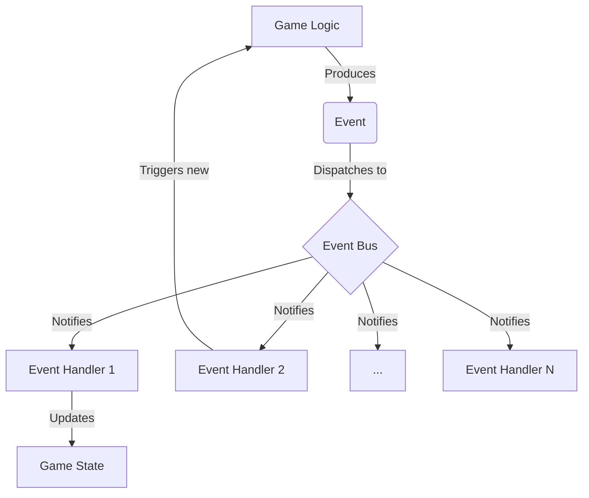

# Werewolf Game Architecture Proposal: Event-Driven Design

## 1. Introduction

This document proposes a new event-driven architecture for the Werewolf game, aiming to improve upon the existing state-machine-based implementation. The current architecture, while functional, can become difficult to manage as new roles and complex game mechanics are introduced. An event-driven approach offers greater flexibility, decoupling components and making the system more modular and extensible.

This proposal will outline the core concepts of the event-driven design, including an Event Bus, a system of Events, and a set of Event Handlers. It will provide a clear path for refactoring the existing codebase to this new architecture, with the goal of creating a more robust and maintainable game engine.

## 2. High-Level Architecture

The core of the proposed architecture is an **Event Bus**, which acts as a central hub for communication between different parts of the game. Game components, such as player actions or phase transitions, will generate **Events**. These events are then dispatched to the Event Bus, which in turn notifies any **Event Handlers** that have subscribed to that type of event.

## 3. Core Components

### 3.1. Events

Events are simple, immutable data structures that represent something that has happened in the game. They should contain all the necessary information for an Event Handler to process them.

**Examples of Events:**

*   `NightPhaseStarted`
*   `PlayerVoted(voter, target)`
*   `WerewolfTargetSelected(target)`
*   `PlayerDied(player, reason)`

### 3.2. Event Bus

The Event Bus is the central dispatcher for all events. It has two main responsibilities:

1.  **Registering Handlers:** It allows different parts of the system to subscribe to specific types of events.
2.  **Dispatching Events:** When an event is published to the bus, it forwards the event to all registered handlers.

### 3.3. Event Handlers

Event Handlers are functions or methods that contain the logic for reacting to an event. Each handler is responsible for a specific piece of game logic. Handlers are registered with the Event Bus and are invoked when a corresponding event is dispatched.

**Examples of Event Handlers:**

*   A handler for `WerewolfTargetSelected` might update the `game.night_kill_target` state.
*   A handler for `PlayerDied` could check for win conditions or trigger a `HunterShoot` event if the deceased player was a Hunter.
*   A handler for `NightPhaseStarted` could trigger the sequence of night actions (Guard, Werewolf, etc.).

## 4. Example: The Night Phase

Here’s how the night phase would work in the event-driven model:

1.  **`NightPhaseStarted` Event:** The game loop dispatches a `NightPhaseStarted` event.

2.  **Night Sequence Handler:** A handler listening for `NightPhaseStarted` begins the night sequence by dispatching a `GuardTurnStarted` event.

3.  **Guard's Action:**
    *   A handler for `GuardTurnStarted` prompts the Guard player for their action.
    *   The Guard's controller dispatches a `GuardProtect` event with the chosen target.
    *   A handler for `GuardProtect` updates the game state with the protected player and then dispatches a `WerewolfTurnStarted` event.

4.  **Werewolves' Action:**
    *   A handler for `WerewolfTurnStarted` prompts the Werewolves for their target.
    *   The Werewolves' controllers collaborate and dispatch a `WerewolfTargetSelected` event.
    *   A handler for `WerewolfTargetSelected` updates the `game.night_kill_target` and then dispatches a `WitchTurnStarted` event.

5.  **This pattern continues** for the Witch and Seer, with each role's action being triggered by an event and, in turn, dispatching another event to continue the sequence.

6.  **`NightPhaseEnded` Event:** After the last night action, a `NightPhaseEnded` event is dispatched.

7.  **Night Resolution Handler:** A handler for `NightPhaseEnded` calculates the outcome of the night (e.g., who was killed, saved, or poisoned) and dispatches `PlayerDied` events as necessary. It then dispatches a `DayPhaseStarted` event to transition the game to the next phase.

## 5. Comparison with State-Machine Architecture

### 5.1. Pros of Event-Driven Architecture

*   **Decoupling:** Components are no longer tightly coupled. For example, the `Witch` logic doesn't need to know about the `Werewolf` logic. It only needs to react to events like `NightPhaseStarted` and `WerewolfTargetSelected`.
*   **Extensibility:** Adding new roles or game mechanics becomes much easier. A new role can be implemented by creating a new set of event handlers without modifying the core game loop or existing role logic. For example, adding a "Thief" role who swaps roles at the beginning of the game would simply involve a handler for a `GameStarted` event.
*   **Flexibility:** Complex interactions, like the Hunter and Black Werewolf King's dying shots, can be handled more elegantly. A `PlayerDied` event can trigger a check for the player's role, and if it's a Hunter, a `HunterShoot` event can be dispatched.
*   **Testability:** Individual event handlers can be tested in isolation, making it easier to write unit tests and ensure the correctness of the game logic.

### 5.2. Cons of Event-Driven Architecture

*   **Complexity:** For very simple games, an event-driven architecture can be overkill. The initial setup of the event bus and handlers can be more complex than a simple state machine.
*   **Traceability:** Following the flow of control can be more difficult in an event-driven system. It may not be immediately obvious which handlers will be triggered by a given event, which can make debugging more challenging.
*   **Potential for infinite loops:** If event handlers are not carefully designed, it's possible to create a chain of events that results in an infinite loop (e.g., Handler A triggers Event B, and Handler B triggers Event A).

## 6. Events and Handlers (Revised)

Here is a comprehensive list of the events and handlers that will be needed to implement the game logic, incorporating your feedback.

### 6.1. Game Flow Events

*   **`GameStarted`**: Dispatched when the game begins.
    *   **Handler**: `InitializeGameHandler` (shuffles roles, sets initial game state).
*   **`NightPhaseStarted`**: Dispatched at the beginning of each night.
    *   **Handler**: `NightPhaseHandler` (initiates the night sequence by dispatching `GuardTurnStarted`).
*   **`DayPhaseStarted`**: Dispatched at the beginning of each day.
    *   **Handler**: `DayPhaseHandler` (initiates the day sequence by dispatching `AnnounceDeaths`).
*   **`GameOver`**: Dispatched when a win condition is met.
    *   **Handler**: `GameOverHandler` (announces the winner and ends the game).

### 6.2. Role-Specific Events (Night)

*   **`GuardTurnStarted`**: Dispatched to start the Guard's turn.
    *   **Handler**: `GuardTurnHandler` (prompts the Guard for their action).
*   **`GuardProtect`**: Dispatched when the Guard chooses a player to protect.
    *   **Handler**: `GuardProtectHandler` (updates game state, dispatches `WerewolfTurnStarted`).
*   **`WerewolfTurnStarted`**: Dispatched to start the Werewolves' turn.
    *   **Handler**: `WerewolfTurnHandler` (dispatches `WerewolfDiscussionStarted`).
*   **`WerewolfDiscussionStarted`**: Dispatched to allow werewolves to discuss.
    *   **Handler**: `WerewolfDiscussionHandler` (allows werewolves to communicate, then prompts for a target).
*   **`WerewolfTargetSelected`**: Dispatched when the Werewolves choose a target.
    *   **Handler**: `WerewolfTargetHandler` (updates game state, dispatches `WitchTurnStarted`).
*   **`WitchTurnStarted`**: Dispatched to start the Witch's turn.
    *   **Handler**: `WitchTurnHandler` (prompts the Witch for their actions).
*   **`WitchSave`**: Dispatched when the Witch chooses to save a player.
    *   **Handler**: `WitchSaveHandler` (updates game state).
*   **`WitchPoison`**: Dispatched when the Witch chooses to poison a player.
    *   **Handler**: `WitchPoisonHandler` (updates game state).
*   **`SeerTurnStarted`**: Dispatched to start the Seer's turn.
    *   **Handler**: `SeerTurnHandler` (prompts the Seer for their action).
*   **`SeerCheck`**: Dispatched when the Seer chooses a player to check.
    *   **Handler**: `SeerCheckHandler` (provides the Seer with the player's role, dispatches `NightPhaseEnded`).

### 6.3. Day Phase Events

*   **`AnnounceDeaths`**: Dispatched at the beginning of the day to announce who died.
    *   **Handler**: `AnnounceDeathsHandler` (announces deaths, dispatches `LastWordsStarted` if applicable, then `SheriffElectionStarted` or `SheriffDecideSpeechOrder`).
*   **`LastWordsStarted`**: Dispatched when a player who has died can speak.
    *   **Handler**: `LastWordsHandler` (prompts the player for their last words).
*   **`SheriffElectionStarted`**: Dispatched on the first day to start the sheriff election.
    *   **Handler**: `SheriffElectionHandler` (manages the election process).
*   **`SheriffDecideSpeechOrder`**: Dispatched when the sheriff needs to decide the speech order.
    *   **Handler**: `SheriffDecideSpeechOrderHandler` (prompts the sheriff for the order, then dispatches `SpeechPhaseStarted`).
*   **`SpeechPhaseStarted`**: Dispatched to begin the speech phase.
    *   **Handler**: `SpeechPhaseHandler` (manages the order of speeches).
*   **`PlayerVoted`**: Dispatched when a player casts a vote.
    *   **Handler**: `VoteHandler` (tallies votes).
*   **`ExecutionComplete`**: Dispatched after a player is executed.
    *   **Handler**: `ExecutionHandler` (dispatches `LastWordsStarted`, checks for win conditions).

### 6.4. Special Role Events

*   **`PlayerDied`**: Dispatched whenever a player dies for any reason.
    *   **Handler**: `PlayerDiedHandler` (checks for Hunter or Black Werewolf King, dispatches `HunterShoot` or `BlackWerewolfKingShoot` if necessary).
*   **`HunterShoot`**: Dispatched when the Hunter dies and can shoot another player.
    *   **Handler**: `HunterShootHandler` (prompts the Hunter for a target, dispatches `PlayerDied`).
*   **`BlackWerewolfKingShoot`**: Dispatched when the Black Werewolf King dies and can shoot another player.
    *   **Handler**: `BlackWerewolfKingShootHandler` (prompts the Black Werewolf King for a target, dispatches `PlayerDied`).

