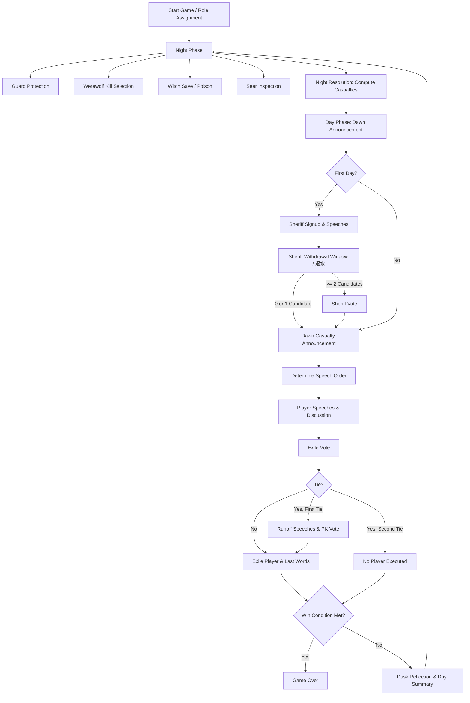

# Werewolf Engine Architecture

## 1. System Overview & Hybrid Design

The Werewolf engine employs a **hybrid architecture** combining a deterministic **Finite State Machine (FSM)** for authoritative game progression with an asynchronous **Event Bus** for decoupled notifications, logging, and UI events.

```mermaid
graph TD
    SM[State Machine (game/states/*)] -->|Phase Progression & Rule Authority| GS[Game State]
    SM -->|Dispatches Domain Events| EB{Event Bus (game/event_bus.py)}
    EB -->|Notifies| H1[UI Handlers (web/controller.py)]
    EB -->|Notifies| H2[Logging System (game/history.py)]
    EB -->|Notifies| H3[Special Ability Handlers]
    Player[Player Controllers (Human / LLM / Web)] -->|Action Input| SM
```

### Core Architecture Principles
1. **State Machine Authority (`game/states/*`):**
   - The State Machine has exclusive authority over turns, player prompts, phase progression, and win-condition checks.
   - Phases (`NightState`, `DayStartState`, `SheriffElectionState`, `DaySpeechState`, `DayVoteState`, `DayEndState`, `GameOverState`) transition cleanly based on game rules.
2. **Notification Event Bus (`game/events/*`, `game/event_bus.py`):**
   - Domain events (`GameStarted`, `PhaseChanged`, `PlayerDied`, `PlayerVoted`, `ExecutionComplete`, `GuardProtect`, `WerewolfTargetSelected`, `WitchSave`, `WitchPoison`, `SeerCheckResult`, `GameOver`) are emitted to decouple secondary concerns.
   - Handlers receive events to broadcast live updates to the web interface and append audit records without entangling core turn logic.
3. **Pluggable Controller Pattern (`game/controllers.py`):**
   - The engine interacts with players via a unified `Controller` interface.
   - Implementations include `HumanController` (CLI stdin), `RandomController` (rule-based dummy), `LLMController` (OpenAI/Groq LLM agent), and `WebController` (FastAPI thread-safe async queue).

---

## 2. Complete Game Flow

The standard game cycle transitions from Night to Day through the following phases:



---

## 3. Key Technical Decisions & Resolved Debts

- **Dusk Memory Synchronization:**
  `DayEndState` synchronizes parallel day summarization across all LLM players using a bounded thread pool barrier (`concurrent.futures.wait`). Day logs are preserved until summarization completes so agents never experience night amnesia on subsequent rounds.
- **Thought Privacy in Live Play & Dead-Player Spectator Mode:**
  `LogType.THOUGHT` entries are strictly segregated while the human player is alive. During live play, living human web players only receive animation signals (`PLAYER_THINKING` / `PLAYER_DONE_THINKING`). Once a human player is eliminated and finishes any death triggers/last words, they may opt into **Spectator God View** (`POST /api/game/spectate`), which unlocks all roles, night actions, and live AI chain-of-thought logs.
- **Sheriff Candidate Withdrawal (`退水`):**
  Candidates in `SheriffSpeechState` may withdraw either during their campaign speech (`withdrew_in_speech` / `"withdraw": true`) or in the dedicated post-speech `SheriffWithdrawState`. If withdrawals leave only 1 candidate, that candidate is automatically elected Sheriff without a ballot; initial podium candidates (`initial_election_players`) remain excluded from casting Sheriff votes even after withdrawing.
- **Human Werewolf Night Kill Priority:**
  In `WerewolfNightState`, AI werewolf teammates whisper their tactical suggestions first, and if a human werewolf is alive in the pack, the final kill target selection is always delegated to the human werewolf rather than chosen at random.
- **Web Controller Non-Blocking Timeouts:**
  `WebController` uses bounded timeouts with automatic fallback actions (e.g., auto-abstain on expired vote turns) preventing the server from hanging when browser clients disconnect.
- **Subclass Polymorphism:**
  Role checks consistently check `isinstance(player.role, Werewolf)` rather than exact string matching, correctly supporting special variants such as `BlackWerewolfKing`.
