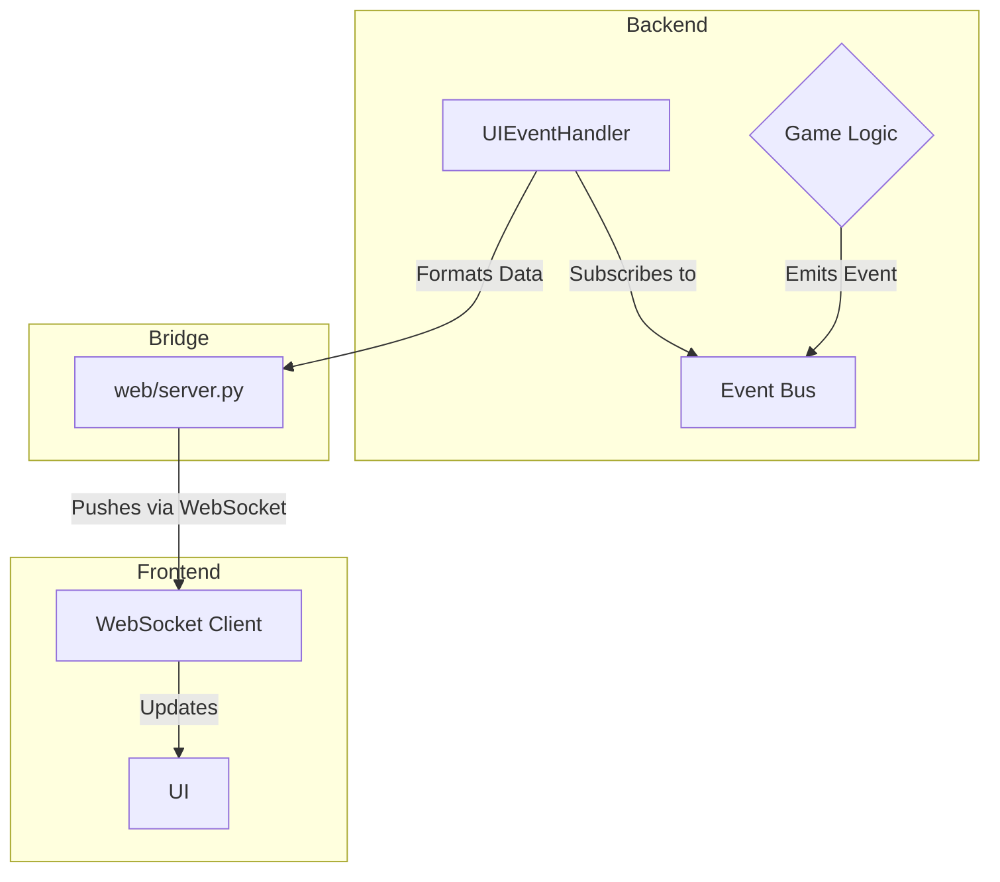

# Refactoring Plan

## Current Progress

So far, the project has undergone a significant architectural shift towards an event-driven model. The core event bus and handler infrastructure are in place. Key nightly roles have been refactored to use this new system:

*   **Guard's Turn:** The `GuardProtect` event and its corresponding handler are implemented.
*   **Werewolf's Turn:** The `WerewolfVote` and `WerewolfKill` events and handlers are complete.
*   **Witch's Turn:** The `WitchAction` event and handler have been refactored.

This foundational work paves the way for the remaining roles to be migrated.

## Next Steps (Backend)

The immediate priority is to complete the backend refactoring for the night phase and transition smoothly into the day.

1.  **Refactor Seer's Turn:**
    *   Create a `SeerCheck` event.
    *   Implement the `handle_seer_check` handler to process the Seer's action and emit a `SeerCheckResult` event.
    *   Ensure the result is only sent to the Seer.

2.  **Implement Night Resolution:**
    *   Create a `NightEnd` event to trigger the resolution logic.
    *   Implement a `handle_night_end` handler that:
        *   Gathers all actions taken during the night (Guard's protection, Werewolf's kill, Witch's actions).
        *   Calculates the final outcome of the night (who died, who was saved).
        *   Emits `PlayerDied` events for any deceased players.

3.  **Transition to Day:**
    *   Create a `DayStart` event.
    *   Implement a `handle_day_start` handler that transitions the game state to the day phase, preparing for announcements and discussion.

## UI Integration Plan

Integrating the new event-driven backend with the existing WebSocket-based UI requires a bridge to translate backend events into UI updates.

*   **UI Event Handler:** A dedicated event handler (`UIEventHandler`) will subscribe to relevant backend events (e.g., `PlayerDied`, `SeerCheckResult`, `GamePhaseChanged`).
*   **Event-to-UI Mapping:** When this handler receives an event, it will format the data into a message that the UI can understand.
*   **WebSocket Bridge:** The `web/server.py` will be responsible for forwarding these formatted messages to the frontend via the existing WebSocket connection. It will act as the intermediary, receiving event-driven updates from the backend and pushing them to the client, without needing to contain any game logic itself.

